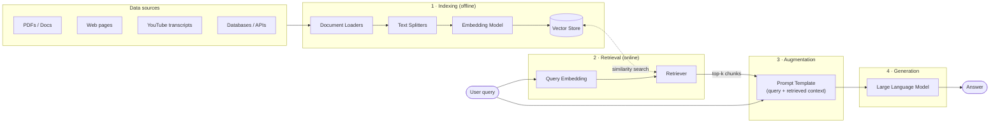
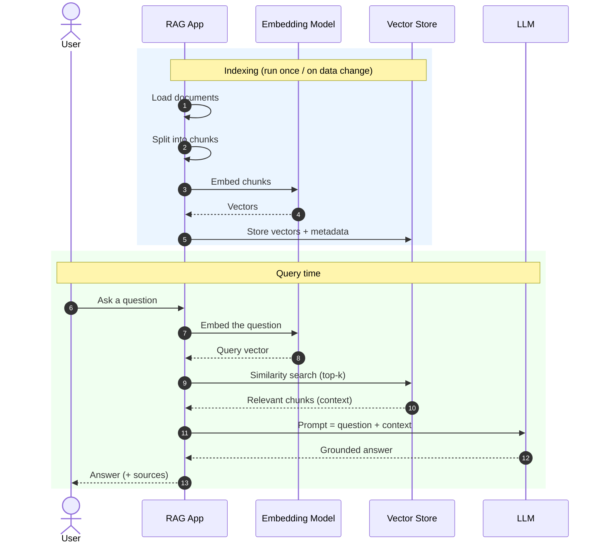
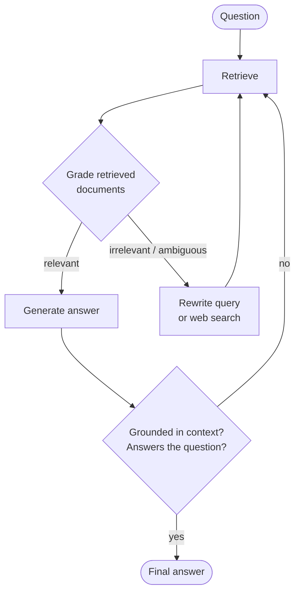

# RAG Playlist

Hands-on code and notes while working through the CampusX
[LangChain / RAG playlist](https://www.youtube.com/watch?v=X0btK9X0Xnk&list=PLKnIA16_Rmva0dRLWEHLznSHKbFD_RJfX&index=1)
— from RAG fundamentals to LangGraph, Corrective RAG and Self-RAG.

## Table of contents

- [What is RAG and why do we need it?](#what-is-rag-and-why-do-we-need-it)
- [Structural diagram](#structural-diagram)
- [RAG workflow](#rag-workflow)
- [Playlist roadmap](#playlist-roadmap)
- [Project structure](#project-structure)
- [Getting started](#getting-started)

---

## What is RAG and why do we need it?

**Retrieval-Augmented Generation (RAG)** lets a Large Language Model answer using
external knowledge that is fetched at query time, instead of relying only on what
it memorised during training.

RAG exists to solve three problems with a plain LLM:

| # | Problem | How RAG helps |
|---|---------|---------------|
| 1 | **Private data** — the model has never seen your documents | Index your own docs and retrieve from them |
| 2 | **Recent developments** — training data has a cutoff | Keep the knowledge base fresh without retraining |
| 3 | **Hallucinations** — the model confidently makes things up | Ground the answer in retrieved context |

---

## Structural diagram

The building blocks of a RAG system and how they relate. Each block maps to one
or more videos in the playlist (see [Playlist roadmap](#playlist-roadmap)).



### Components at a glance

| Component | Responsibility | LangChain building block |
|-----------|----------------|--------------------------|
| Document Loader | Pull raw content from a source into `Document` objects | `langchain_community.document_loaders` |
| Text Splitter | Break documents into chunks that fit the context window | `RecursiveCharacterTextSplitter`, … |
| Embedding Model | Turn text into dense vectors | `OpenAIEmbeddings`, `HuggingFaceEmbeddings`, … |
| Vector Store | Store vectors and run similarity search | `Chroma`, `FAISS`, … |
| Retriever | Given a query, return the most relevant chunks | `vectorstore.as_retriever()`, MMR, multi-query, … |
| Prompt | Combine the question with retrieved context | `ChatPromptTemplate` |
| LLM | Generate the final, grounded answer | `ChatOpenAI`, `ChatAnthropic`, … |

---

## RAG workflow

### End-to-end sequence



### The four stages

1. **Indexing** *(offline)*
   Load → split → embed → store. Done ahead of time so queries are fast.
2. **Retrieval** *(online)*
   Embed the user's question and fetch the top-k most similar chunks from the vector store.
3. **Augmentation**
   Insert the retrieved chunks and the user's question into a prompt template.
4. **Generation**
   The LLM uses the user's query **and** the retrieved, augmented context to produce the response.

### Beyond basic RAG (later videos)

The last part of the playlist makes the pipeline *adaptive* by turning it into a
graph with decision points.



- **RAG using LangGraph** — model the pipeline as a stateful graph (nodes + edges).
- **Corrective RAG (CRAG)** — grade retrieval quality and fall back to query rewriting / web search.
- **Self-RAG** — the model critiques its own retrieval and generation and retries when needed.

---

## Playlist roadmap

| # | Video | Topic | Folder | Status |
|---|-------|-------|--------|--------|
| 1 | RAG \| How does RAG Work \| RAG Explained | Fundamentals, why RAG, architecture | [`01_rag_fundamentals`](01_rag_fundamentals) | ⬜ |
| 2 | Document Loaders in LangChain | Text, PDF, CSV, directory and web loaders — [notes & scripts](02_document_loaders/README.md) | [`02_document_loaders`](02_document_loaders) | ⬜ |
| 3 | Text Splitters in LangChain | Chunking strategies | [`03_text_splitters`](03_text_splitters) | ⬜ |
| 4 | Vector Stores in LangChain | Embeddings + vector DBs | [`04_vector_stores`](04_vector_stores) | ⬜ |
| 5 | Retrievers in LangChain | Retrieval strategies | [`05_retrievers`](05_retrievers) | ⬜ |
| 6 | YouTube Chatbot using LangChain | First end-to-end RAG system | [`06_youtube_chatbot`](06_youtube_chatbot) | ⬜ |
| 7 | RAG using LangGraph | Agentic RAG as a graph | [`07_rag_langgraph`](07_rag_langgraph) | ⬜ |
| 8 | Advanced RAG: Corrective RAG (CRAG) | Retrieval grading + fallback | [`08_corrective_rag`](08_corrective_rag) | ⬜ |
| 9 | Self-RAG Tutorial | Self-reflective RAG | [`09_self_rag`](09_self_rag) | ⬜ |
| 10 | _TBD — fill in once reviewed_ | | [`10_tbd`](10_tbd) | ⬜ |

---

## Project structure

```text
rag-playlist/
├── README.md
├── pyproject.toml            # Dependencies, managed with uv
├── .python-version           # Python version pinned for uv
├── .env.example              # API keys template (copy to .env)
├── .gitignore
│
├── data/
│   ├── raw/                  # Source documents (PDFs, text, …) — git-ignored
│   └── vectorstore/          # Persisted vector DBs — git-ignored
│
├── src/rag_playlist/         # Reusable code shared across modules
│   ├── config.py             # Env / settings loading
│   ├── loaders.py            # Document loading helpers
│   ├── splitters.py          # Chunking helpers
│   ├── vectorstore.py        # Embeddings + vector store helpers
│   ├── retrievers.py         # Retriever factories
│   └── chains.py             # Prompt + LLM chain builders
│
├── 01_rag_fundamentals/      # One folder per video: README (notes) + notebooks/scripts
├── 02_document_loaders/
│   ├── README.md             # Loaders covered, how to run, source repo link
│   ├── scripts/              # text / pdf / csv / directory / web loader scripts
│   └── data/                 # Sample inputs (cricket.txt, CSV, PDFs, books/)
├── 03_text_splitters/
├── 04_vector_stores/
├── 05_retrievers/
├── 06_youtube_chatbot/
├── 07_rag_langgraph/
├── 08_corrective_rag/
├── 09_self_rag/
└── 10_tbd/
```

Each module folder follows the same convention:

```text
NN_topic/
├── README.md        # Video link, key concepts, notes, TODO checklist
├── notebooks/       # Jupyter notebooks that follow along with the video
├── scripts/         # Cleaned-up, runnable versions
└── data/            # (optional) Sample inputs that ship with the module's scripts
```

Each video's README lives in its own folder; this top-level README stays the overview.

---

## Getting started

This project uses [uv](https://docs.astral.sh/uv/) for environment and dependency management.

```bash
# 1. Create the virtual environment and install dependencies (from pyproject.toml)
uv sync

# 2. Configure API keys
cp .env.example .env
# then edit .env and add your keys

# 3. Launch Jupyter and open a module's notebook
uv run jupyter lab

# Add a new dependency when a video needs one
uv add <package>
```

> Work through the modules in order — each one builds on the previous.
